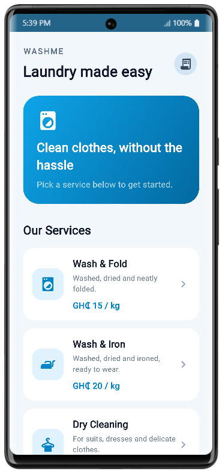
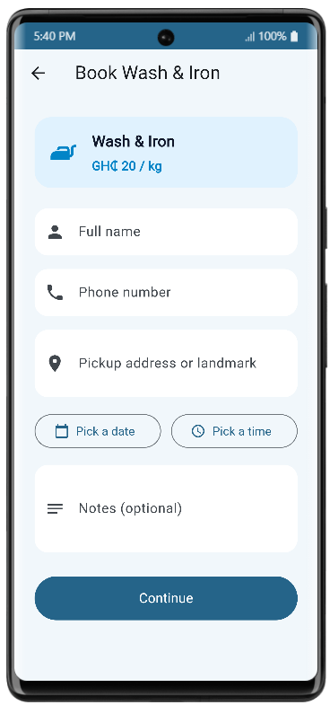
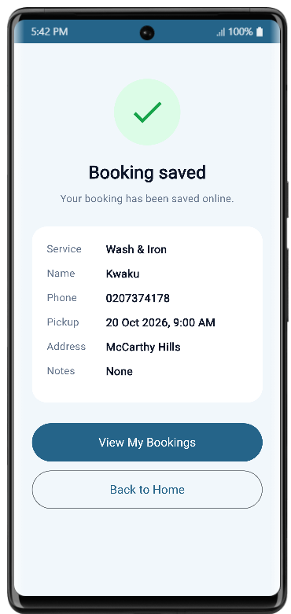
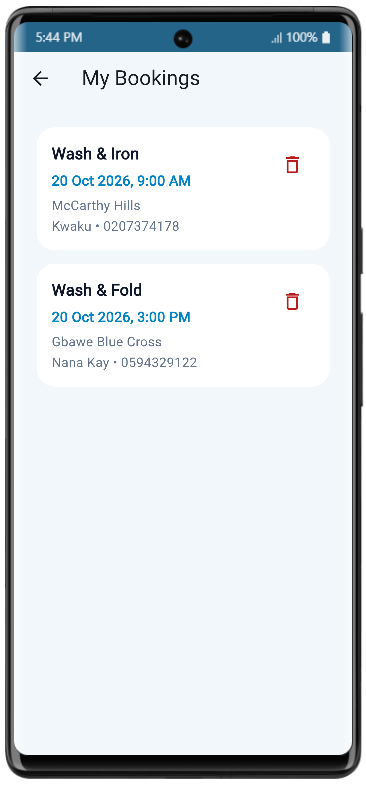

# WashME

A Flutter laundry booking app. Customers browse laundry services, fill in a booking form, and their bookings are saved online with Firebase.

## Screenshots

| Home | Booking form | Confirmation | My Bookings |
|------|--------------|--------------|-------------|
|  |  |  |  |

## Features

- Browse laundry services with prices (sample data)
- Booking form with validation: name, phone number, pickup address or landmark, pickup date and time, optional notes
- Pickup times in the past are rejected
- Bookings are saved online in Cloud Firestore
- Confirmation screen after booking
- My Bookings screen with the option to cancel a booking
- The customer's name and phone number are remembered on the device and filled in next time
- Friendly error messages and a "Try again" option when the internet fails

## How it works

1. The home screen lists the services from a local list in the code.
2. Tapping a service opens the booking form for that service.
3. When the form is submitted, the app signs the user in anonymously with Firebase Authentication, so each install has a private user ID.
4. The booking is saved as a document in the Firestore `bookings` collection, stamped with that user ID.
5. The My Bookings screen asks Firestore only for bookings that carry the user's own ID.
6. SharedPreferences stores the customer's name and phone number on the device to pre-fill the form.

## Technology

- **Flutter** and **Dart**
- **Cloud Firestore** for storing bookings
- **Firebase Authentication** (anonymous sign-in)
- **SharedPreferences** for small settings kept on the device
- **Git and GitHub** for version control
- **Visual Studio Code** for development

## Project structure

```
lib/
  main.dart               App start, Firebase setup, home screen and service cards
  laundry_service.dart    The service model and the list of services
  booking_page.dart       Booking form with validation
  booking.dart            The booking model (to and from JSON)
  booking_storage.dart    Saves, loads and deletes bookings in Firestore
  confirmation_page.dart  Screen shown after a booking
  my_bookings_page.dart   List of the user's bookings
  user_preferences.dart   Remembers name and phone with SharedPreferences
  firebase_options.dart   Firebase settings generated by FlutterFire
test/
  washme_test.dart        Automated tests
screenshots/              Images used in this README
```

## Firestore security rules

Bookings can only be created, read or deleted by the user whose ID is stamped on them. Editing is not allowed.

```
rules_version = '2';
service cloud.firestore {
  match /databases/{database}/documents {
    match /bookings/{bookingId} {
      allow create: if request.auth != null
                    && request.resource.data.userId == request.auth.uid;
      allow read, delete: if request.auth != null
                    && resource.data.userId == request.auth.uid;
      allow update: if false;
    }
  }
}
```

## Running the app

You need the Flutter SDK installed.

```
flutter pub get
flutter run -d chrome
```

The app connects to the author's Firebase project through `firebase_options.dart`. To use your own, create a Firebase project, enable Anonymous sign-in and Firestore, publish the rules above, and run `flutterfire configure`.

To run the automated tests:

```
flutter test
```

## Current status

- Tested in Google Chrome.
- Not yet tested on an Android emulator or a physical phone.
- Automated tests cover the booking model, pickup time formatting, the services list and a service card. Firestore and sign-in are not covered by automated tests.

## Known limitations

- Service prices are sample values.
- Users are anonymous. An anonymous ID belongs to one browser or app install, so clearing browser data or switching device means the bookings are no longer shown.
- The pickup address is typed text. There is no map.
- There is no payment, and no laundry business side to view or manage bookings.

## Possible improvements

- Sign-in with email or Google, so bookings follow the user across devices
- Map or location picker for the pickup address
- Booking status updates and notifications
- Tests for the Firestore storage using a fake database
- Testing on Android devices